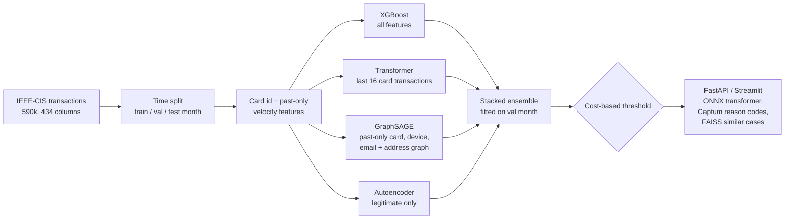

# Deep Learning Fraud Detection

[](https://github.com/rc-mathew/deep-learning-fraud-detection/actions/workflows/tests.yml)
[](https://rc-mathew-fraud-detection.streamlit.app)

**Live demo: [rc-mathew-fraud-detection.streamlit.app](https://rc-mathew-fraud-detection.streamlit.app)**: score unseen test-month transactions, see the block/allow decision, reason codes and similar past fraud cases.

**Run the demo locally in a couple of minutes** (CPU only; the demo data ships with the repo):

```bash
git clone https://github.com/rc-mathew/deep-learning-fraud-detection
cd deep-learning-fraud-detection
pip install -r requirements.txt
streamlit run app/streamlit_app.py
```


Fraud detection on [IEEE-CIS](https://www.kaggle.com/c/ieee-fraud-detection) built from deep learning models:
a transaction transformer with self-supervised pretraining, a graph neural network over shared
devices and emails, and an autoencoder for unlabelled anomalies. XGBoost is kept as one baseline row.

Every model is judged on the same **time-based split** (train on the past, test on the last 30 days) and on
**recall at 1% false-positive rate**, not ROC-AUC alone.

**TL;DR:** I built a transformer from scratch, a graph neural network and an autoencoder to beat XGBoost on
card fraud. Together they barely do (+0.6 points of recall at 1% FPR), and this repo measures exactly where
that small gain comes from, including how much of it is a labelling artefact of the dataset.

## Summary

- **Best model: a stacked ensemble** of XGBoost, the transformer, GraphSAGE and the autoencoder. It catches
  **47.6% of fraud at a 1% false-positive rate** (PR-AUC 0.562, ROC-AUC 0.915) on a month it never saw.
- **Deep learning adds little over XGBoost here:** +0.6 points of recall at 1% FPR, almost all from the transformer,
  and part of that comes from how IEEE-CIS labels card history (first-fraud recall drops 1.5 points).
- **Cost-based threshold:** $179k expected loss on the test month, against $295k at a 1% FPR threshold and $457k
  for blocking nothing, at an assumed $10 per wrongly blocked customer.
- **Serving:** the transformer exported to ONNX scores a transaction in 0.5 ms on one CPU thread (3.2x faster
  than PyTorch); INT8 makes it 3.6x smaller with the same accuracy.

## Architecture



## Results (test set: last 30 days)

| Model | Recall @ 1% FPR | Recall @ 5% FPR | PR-AUC | ROC-AUC | First-fraud recall @ 1% FPR | Ring-fraud recall @ 1% FPR |
| --- | --- | --- | --- | --- | --- | --- |
| XGBoost baseline | 0.470 | 0.650 | 0.551 | 0.903 | **0.541** | 0.779 |
| Transformer, from scratch | 0.378 | 0.590 | 0.430 | 0.858 | 0.414 | not measured |
| Transformer, pretrained | 0.381 | 0.565 | 0.418 | 0.859 | 0.393 | not measured |
| GNN (GraphSAGE) | 0.310 | 0.488 | 0.355 | 0.842 | 0.351 | 0.591 |
| Autoencoder (no labels) | 0.007 | 0.344 | 0.121 | 0.772 | 0.011 | 0.009 |
| **Ensemble (stacked)** | **0.476** | **0.685** | **0.562** | **0.915** | 0.526 | **0.786** |
| Rank average (no fitting) | 0.394 | 0.615 | 0.460 | 0.896 | 0.436 | 0.734 |

First-fraud recall drops transactions from cards that already had a fraud (see Known caveat).

**Weeks 5-6 finding.** Masked-field pretraining worked as a task: its loss fell every epoch, from 1.24 to 0.44
over 10 epochs. It lifted validation PR-AUC from 0.515 to 0.557, but that gain did not carry to the test
month (0.430 vs 0.418). Pretraining saw the validation period's transactions, so its validation gain is
partly familiarity with that month. Both transformers trail XGBoost by about 9 points of recall at 1% FPR.
They see about 40 fields per transaction, while XGBoost uses all 434, including the V and full C/D columns.
Whether the transformer adds anything is tested in the week 8 ensemble.

**Week 7 finding.** The past-only entity graph has 3,874,622 edges (card 1,214,284; device 204,552;
email domain + address 2,455,786). Ring transactions, whose device was used earlier by a different card,
are 6.2% of the test month (5,311 rows) and 16.7% of them are fraud, almost 5x the base rate, so shared
devices are a real signal. XGBoost still catches more of that ring fraud (77.9% vs 59.1%), likely because
its per-card features and 434 columns already capture much of it. GraphSAGE was still improving when it
hit its 300-epoch cap on CPU (validation PR-AUC 0.45), so it is undertrained. The autoencoder, trained
without labels, ranks fraud above chance (ROC-AUC 0.77, 34% recall at 5% FPR) but is almost useless at
1% FPR; its value, if any, is as an extra signal in the ensemble. XGBoost rows differ slightly between
runs (0.466 GPU, 0.470 CPU).

**Week 8 finding.** A logistic-regression stack fitted on the validation month (weights: XGBoost 1.33,
transformer 0.49, autoencoder 0.16, GraphSAGE -0.03) beats XGBoost alone, but only slightly: +0.6 points of
recall at 1% FPR, +3.5 at 5% FPR, +0.011 PR-AUC. Leaving each model out shows where that comes from: the
transformer adds most of it (PR-AUC 0.554 without it), GraphSAGE adds nothing, the autoencoder almost nothing.
The gain is not free: first-fraud recall falls from 0.541 to 0.526, so part of what the transformer adds is the
card-history labelling effect, not fraud the bank could catch earlier.

- **Calibration.** Both are well calibrated on the test month (expected calibration error 0.003 ensemble,
  0.006 XGBoost; Brier 0.022 each), so the stack's scores can be read as probabilities.
- **Cost threshold.** With a missed fraud costing its amount and a blocked good customer an assumed $10, the
  threshold chosen on validation flags 9.5% of good customers and catches 76.5% of fraud (77.9% of fraud
  dollars). Test cost: $179k, against $295k at the 1% FPR threshold and $457k blocking nothing. Blocking 1 in
  10 good customers is aggressive; the $10 assumption drives it, and a real team would set that cost.
- **Fairness at that threshold (overall FPR 9.5%).** Good customers are blocked more often on Discover cards
  (2.7x), credit cards (1.9x vs 0.7x for debit), products C (2.9x) and H (1.8x), and when the country code is
  missing (2.9x). Each of these groups also has a higher fraud rate (credit 6.3% vs debit 2.6%; product C 13.6%),
  so the model is following real risk, but those customers still carry more of the false alarms.
- **Reason codes** (Captum Integrated Gradients on the transformer, top 200 flagged): C1, C14, C13 and C2 lead,
  then the M match flags and TransactionAmt. IEEE-CIS anonymises what the C and M fields mean, so these codes
  point at fields, not at explanations a customer could read.

## Serving the transformer on CPU

Single-transaction scoring on Kaggle's CPU (1 thread), test month, the week 8 transformer:

| Format | Size | p50 latency | p95 latency | Recall @ 1% FPR | PR-AUC |
| --- | --- | --- | --- | --- | --- |
| PyTorch fp32 | 4.31 MB | 1.65 ms | 1.89 ms | 0.353 | 0.405 |
| ONNX fp32 | 2.38 MB | **0.52 ms** | **0.59 ms** | 0.353 | 0.405 |
| ONNX INT8 | **0.66 MB** | 0.55 ms | 0.89 ms | 0.352 | 0.406 |

Exporting to ONNX gives the speed-up (3.2x at p50). INT8 quantisation, including the embedding tables, makes the
file 3.6x smaller than ONNX fp32 with the same recall and PR-AUC, but it is not faster and its p95 is worse, and
single scores can move by up to 0.18 even though the ranking holds. ONNX fp32 is the better choice for latency;
INT8 only if size matters.

**Similar-case search (FAISS).** 17,669 past confirmed frauds are indexed by the transformer's last-token vector.
Test frauds and test legitimate transactions are equally close to their nearest past fraud (mean cosine similarity
0.893 vs 0.900), so the index is a lookup tool for investigators ("show me similar past cases"), not a fraud signal.


## Kaggle runs (public, with outputs)

| Step | Notebook |
| --- | --- |
| 1. Time split, card sequences, XGBoost baseline | [Fraud DL 1](https://www.kaggle.com/code/reubencmathew74/fraud-dl-1-time-split-xgboost-baseline) |
| 2. Transformer from scratch vs masked pretraining | [Fraud DL 2](https://www.kaggle.com/code/reubencmathew74/fraud-dl-2-transformer-masked-pretraining) |
| 3. GraphSAGE and autoencoder | [Fraud DL 3](https://www.kaggle.com/code/reubencmathew74/fraud-dl-3-graphsage-autoencoder) |
| 4. Ensemble, calibration, cost threshold, fairness, reason codes | [Fraud DL 4](https://www.kaggle.com/code/reubencmathew74/fraud-dl-4-ensemble-cost-threshold-fairness) |
| 5. ONNX INT8 and FAISS similar-case search | [Fraud DL 5](https://www.kaggle.com/code/reubencmathew74/fraud-dl-5-onnx-int8-faiss-case-search) |

## Data pipeline (week 4)

1. **Load** `train_transaction.csv` + `train_identity.csv` (Kaggle's test files have no labels, so they are not used).
2. **Card id.** IEEE-CIS has no card id. `uid = card1 + addr1 + (day − D1)`, since D1 counts days since
   the card's first transaction.
3. **Time split.** Last 30 days = test, the 30 before = validation, the rest = train
   (`config.GAP_DAYS` adds a gap to mimic late chargebacks).
4. **Velocity features**, past-only per card: transaction counts and amount sums in the last 1 h / 24 h / 7 d,
   seconds since the previous transaction, and amount vs the card's earlier average.
5. **Sequence table** for the transformer: one encoded row per transaction, sorted by card then time.
   Vocabularies and scaling are fitted on train rows only. `window_indices()` returns each transaction's
   last 16 card transactions. Earlier transactions' labels are never inputs.

```
src/fraud_dl/
  config.py      split sizes, windows, sequence columns
  data.py        load, card id, time split, sort by card
  features.py    velocity features
  sequences.py   encoder + sequence windows
  metrics.py     recall @ FPR, PR-AUC, ROC-AUC
  prepare.py     python -m fraud_dl.prepare --data-dir ... --out-dir artifacts
  baseline.py    python -m fraud_dl.baseline --artifacts artifacts
  transformer.py transformer written from scratch, masked-field pretraining, fine-tuning
  transformer_run.py  python -m fraud_dl.transformer_run --artifacts artifacts
  graph.py       past-only entity graph (card, device, email + address) and GraphSAGE
  anomaly.py     autoencoder trained on legitimate transactions
  week7_run.py   python -m fraud_dl.week7_run --artifacts artifacts
  ensemble.py    stacked ensemble, calibration, cost-based threshold, fairness
  explain.py     Captum Integrated Gradients reason codes for the transformer
  week8_run.py   python -m fraud_dl.week8_run --artifacts artifacts
  optimize.py    ONNX export, INT8 quantisation, CPU latency, FAISS similar-case index
  optimize_run.py  python -m fraud_dl.optimize_run --artifacts artifacts
  build_demo.py  demo bundle: test-month sample with live-scorable windows
  serve.py       scorer used by the API and the demo (numpy + onnxruntime only)
notebooks/week4_data_and_baseline.ipynb   week 4 on Kaggle or Colab
notebooks/week5_6_transformer.ipynb       weeks 5-6 on a Kaggle GPU
notebooks/week7_graph_autoencoder.ipynb   week 7 on Kaggle
notebooks/week8_ensemble_explain.ipynb    week 8 on Kaggle
notebooks/week8b_onnx_faiss.ipynb         ONNX INT8 + FAISS, from week 8's output
notebooks/build_demo_bundle.ipynb         demo/ bundle for the API and Streamlit app
app/api.py             FastAPI: GET /health, GET /transactions, POST /score
app/streamlit_app.py   Streamlit demo
tests/           pipeline tests on a synthetic IEEE-CIS-shaped dataset
```

## Run

On Kaggle or Colab, open `notebooks/week4_data_and_baseline.ipynb` (setup steps are in its first cell). Locally:

```bash
pip install -e ".[dev]"
pytest
python -m fraud_dl.prepare --data-dir path/to/ieee-fraud-detection --out-dir artifacts
python -m fraud_dl.baseline --artifacts artifacts
```

## Demo and API

```bash
pip install -r requirements.txt
uvicorn app.api:app --port 8000          # POST /score {"transaction_id": 3557572}
streamlit run app/streamlit_app.py
```

The demo serves 1,000 test-month transactions (300 fraud, 700 legitimate). The transformer scores each one live
with ONNX Runtime; the ensemble score, decision, reason codes and similar past cases come from the week 8 run,
because XGBoost and GraphSAGE need the full feature table and graph, which are too large to ship.

## Known caveat

IEEE-CIS labels later transactions of a defrauded account as fraud too: after a card's first fraud, 44.7% of its
later transactions are fraud, against 3.5% overall. Models that see card history pick that up, which flatters
them compared with production. Every model therefore also reports **first-fraud recall**: recall at 1% FPR
on transactions from cards with no earlier fraud.
